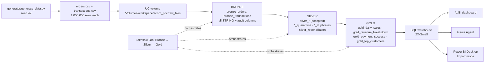

# Trustworthy E-commerce Lakehouse on Databricks (Medallion Architecture)

**Student:** ⟨your name⟩ · **Instructor:** Lipton Ahammed · **Submitted:** 19 Nov 2026
**Repository:** ⟨GitHub repo URL⟩ · **AI/BI dashboard:** ⟨published dashboard link⟩

All results and screenshots in `evidence/` come from my own Databricks free-trial workspace. All data is synthetic (seed 42). No credentials or personal data are committed.

---

## 1. Business context
An e-commerce company receives daily CSV extracts of **orders** and **payment transactions**. The extracts contain nulls, invalid types, inconsistent labels, bad or future timestamps, orphan references and duplicates, so sales reports can't be trusted.
This project keeps the raw evidence (**Bronze**), cleans it with explicit, auditable rules (**Silver**) and publishes documented business metrics (**Gold**). The metrics feed an AI/BI dashboard, a Genie Agent and Power BI, and all three report the **same revenue**.

## 2. Architecture

| Layer | What happens | Code |
|---|---|---|
| Landing | Raw CSVs stored unchanged in a Unity Catalog managed volume | `notebooks/00_setup.py`, `sql/01_setup.sql` |
| Bronze | Lossless load: every column STRING, plus audit columns, idempotent per batch | `notebooks/01_bronze_ingestion.py` |
| Silver | Standardise → safe typing → validate → quarantine → deduplicate → reconcile | `notebooks/02_silver_transform.py`, `03_…evidence.py` |
| Gold | Business marts with one revenue definition, documented grain, quality checks | `notebooks/04_gold_models.py` |
| Serve | Dashboard, Genie and Power BI on the Gold tables only | `sql/08`, `dashboards/`, `powerbi/` |
| Operate | Lakeflow Job, least-privilege grants, cleanup | `operations/`, `sql/06_grants.sql` |

## 3. Trial workspace and environment

| Item | Value |
|---|---|
| Account type | Databricks **free trial** (express setup), signed up with my own email |
| Cloud / region | **AWS · us-west-2** (Databricks-managed serverless workspace, Premium tier, identity federation enabled) |
| Workspace URL | `https://dbc-cab28b6d-cd1f.cloud.databricks.com` |
| Trial start / expiry | 18 Nov 2026 / **2 Dec 2026** (14 days) |
| Credits | $400 trial credit. ⟨remaining at the end, from the billing page⟩ |
| Storage / catalog | Databricks-managed storage · catalog `workspace` · schema `ecom_poc` · volume `raw_files` |
| ETL compute | Serverless notebook and job compute |
| BI compute | One SQL warehouse ("Serverless Starter Warehouse"): **2X-Small (4 DBU/h)**, auto stop 10 min, scaling 1–1 |

**Trial vs Free Edition.** The free trial is the full commercial platform for 14 days, paid for by $400 of credits. It includes Unity Catalog, serverless compute, SQL warehouses, AI/BI, Genie and partner connectors. After the trial, a payment method is needed. Free Edition is permanently free and quota-limited, meant for learning and non-commercial use, with restricted compute and features. The assignment required the trial, so Free Edition wasn't used. No payment method was added and nothing was upgraded.

**Naming and raw path.** `catalog.schema.object`, lower snake case, with layer prefixes `bronze_`, `silver_`, `gold_`, plus `ref_` (reference data) and `ops_` (operational evidence). Rejected and duplicate rows go to tables with the suffixes `_quarantine` / `_duplicates`.
Raw files: `/Volumes/workspace/ecom_poc/raw_files/orders.csv` and `/Volumes/workspace/ecom_poc/raw_files/transactions.csv`.

**Compute and credit control.** ETL runs on serverless compute: it starts fast, scales for 1M rows and stops when idle, so no cluster is left running. BI uses one SQL warehouse, because dashboards, Genie and the Power BI connector need one. I chose the smallest size (2X-Small) since the Gold tables are small, with a 10-minute auto stop. The job ran on demand, with no active schedule. Dashboard datasets weren't materialized, so no daily refresh job runs. Power BI uses **Import** mode, so the warehouse can stay off.

**Git.** GitHub repository linked through a Databricks **Git folder** with a fine-grained token limited to this one repo. Work was committed stage by stage (setup → generator/notebooks → Bronze → Silver → Gold → BI → operations).

**Trial limitations observed**

| Limitation | Effect / fallback |
|---|---|
| Only one SQL warehouse (trial) | All BI work used the Starter Warehouse at 2X-Small |
| Notebook widgets shown in a new "Parameters" side panel | No impact; defaults `workspace` / `ecom_poc` were used |
| ⟨anything else you hit, or delete this row⟩ | |

## 4. Synthetic source data
`generator/generate_data.py` (seed 42) creates both files deterministically: re-running it gives byte-identical files. `generator/verify_data.py` independently re-detects every injected issue from the raw values. The inventory is in `generator/dirty_data_report.md`.

| File | Data rows (excl. header) | Bytes | Verified in Databricks |
|---|---:|---:|---|
| orders.csv | 1,000,000 | 72,428,604 | `ops_source_inventory`, `read_files` count |
| transactions.csv | 1,000,000 | 76,459,630 | same |

**14 anomaly types per file** (≥ 5 required): nulls/blanks, text in numeric fields, negative and out-of-range values, invalid and future timestamps, inconsistent case/whitespace, unknown statuses/currencies, orphan order ids, exact duplicate rows and duplicate keys with different content. Each row has at most one anomaly, so the counts are exact. About 9% of rows are affected.

**Why a small, measured fraction?** With known counts, every rule can be verified exactly: expected rows equal quarantined rows. The data also stays realistic, so Gold metrics describe a believable business. A large or unknown dirty share would hide broken rules and make the metrics meaningless.

**Why no real data, credentials or raw extracts in Git?** Git history is permanent and gets copied to every clone, so a leaked secret or personal record can't truly be removed. Real data carries privacy and legal obligations that a code repo can't meet, and raw extracts are large and change daily. **Minimum production controls:** `.gitignore` for data and secrets (included); secret scanning with push protection; secrets in a vault or Databricks secrets, never in code; data only in governed Unity Catalog storage with least-privilege grants and audit logs; masked or synthetic data in dev; short-lived tokens or OAuth; branch protection with code review.

## 5. Bronze: lossless ingestion
Each CSV loads into its own Delta table using an **explicit all-STRING schema** (no inference), so nothing is altered or rejected on read.
**Why keep malformed data?** Bronze is the record of *what was received*. Dropping bad rows on read would make it impossible to prove what the source sent, measure quality, fix a rule and reprocess, or answer an audit. Judging data is Silver's job.

| Audit column | Purpose |
|---|---|
| `_ingested_at` | When the row was loaded |
| `_source_file` | Which file it came from (`_metadata.file_path`) |
| `_batch_id` | Deterministic delivery key `file:size:modification time`, which makes re-runs idempotent |
| `_row_hash` | SHA-256 of all source values, for exact-duplicate and change detection |
| `_bronze_row_id` | Unique deterministic row id, carried into every Silver outcome for reconciliation |

**Lossless and idempotent.** Source rows are counted independently of the parser (lines minus header) and must equal Bronze rows, or the notebook fails. Writes use `replaceWhere _batch_id = …`, so a re-run replaces its own batch instead of appending. **Evidence:** after two runs, `ops_bronze_load_log` still shows 1,000,000 rows per table. Source = Bronze = 1,000,000 for both files (PASS).

## 6. Silver: cleaning, validation and reconciliation
**Precedence:**
1. Standardise: trim, null tokens (`''`, `NULL`, `None`, `N/A`) become NULL, case is normalised.
2. Type safely: `try_cast` / `try_to_timestamp`.
3. Validate against the rule matrix; any failure sends the row to quarantine.
4. Deduplicate the remaining **valid** rows.
5. Reconcile.

Each Bronze row ends up in exactly one bucket. The rules (20 for orders, 18 for transactions) are in `sql/02_business_rules_matrix.md`, with counts per rule in `silver_rule_counts`.

**Unparseable strings:** `try_cast` returns NULL instead of crashing. The rule then sees "value present, typed value NULL" and quarantines the row with a specific reason. For example, `"3 pcs"` → `non_numeric_quantity`. Cosmetic issues are fixed and accepted: `" DELIVERED "` → `delivered`.

**Keep-one rule (deterministic `ROW_NUMBER`):**
- **Exact duplicate:** the whole row is identical (same `_row_hash`), so keep the lowest `_bronze_row_id`.
- **Duplicate key, different content:**
  - Orders: keep the most advanced lifecycle status (pending < processing < shipped < delivered < cancelled < returned).
  - Transactions: keep the latest `txn_ts`.
  - Ties: lowest `_row_hash`.

Losers keep `duplicate_type` and `winner_bronze_row_id`.

**Quarantine, never silent deletion.** Invalid rows keep all their raw values, a `rejection_reason` array listing every failed rule, and the Bronze audit ids.

**Reconciliation (my run, all PASS, overlap 0):**

| Dataset | Bronze | Accepted | Quarantined | Duplicate losers | Exact / key dup |
|---|---:|---:|---:|---:|---:|
| orders | 1,000,000 | 938,000 | 52,000 | 10,000 | 5,000 / 5,000 |
| transactions | 1,000,000 | 891,725 | 98,799 | 9,476 | 4,754 / 4,722 |

Transactions have more quarantined rows because 51,718 belong to a quarantined order (`parent_order_not_accepted`). The relationship check stops revenue from orders without a valid category or country. Lineage can be traced end to end by `_bronze_row_id` (notebook 03, section 7).

## 7. Gold: business-ready models
**Revenue definition.** Net revenue (USD) = Σ `amount_usd` of accepted **SUCCESS** transactions − Σ `amount_usd` of accepted **REFUNDED** transactions, attributed to the order's `order_date`.
- **Source of truth:** `silver_transactions`, i.e. money actually captured. `order_amount_usd` (quantity × price) is booked value, not revenue.
- FAILED and PENDING never count. A retry (FAILED then SUCCESS) counts once.
- Split payments: every SUCCESS row counts.
- Repeat rows for the same `txn_id` are removed in Silver.
- Refunds are subtracted. A cancelled order without a successful payment contributes 0.
- Currencies are converted with the fixed `ref_fx_rates` table.

| Example order | Transactions | Net revenue |
|---|---|---|
| Retry | FAILED 965 INR, then SUCCESS 965 INR (11.58 USD) | **11.58** |
| Split | SUCCESS + SUCCESS halves | sum of both |
| Returned | SUCCESS 2,414.29 BDT, then REFUNDED 2,414.29 BDT | **0.00** |

| Gold table | Grain (unique key) | Rows |
|---|---|---:|
| `gold_daily_sales` | `order_date` | 669 |
| `gold_revenue_breakdown` | `order_date, category, country` | 53,467 |
| `gold_payment_success` | `txn_date, payment_method` | 4,097 |
| `gold_top_customers` | `customer_id` | 145,749 |
| `gold_order_revenue` (helper) | `order_id` | 938,000 |

**No fan-out.** One order can have several transactions. They are **aggregated per order first** and then joined 1:1 to orders, so values are never multiplied. Assertions check that the order count is preserved and that revenue is identical across all Gold tables and Silver.

**Documentation.** Every Gold table and key column has a Unity Catalog comment, plus `grain` and `revenue_definition` table properties. Readers know what one row means, which date and currency apply, and that rates must be recomputed as SUM/SUM rather than averaged. Genie uses these descriptions too.

**Key results:** net revenue **$81,332,656** · orders **938,000** · cancellation rate **11.34%** · payment success **90.88%** (lowest: bank_transfer 85.5%, highest: PayPal 93.3%).

## 8. Consumption: AI/BI, Genie and Power BI
**AI/BI dashboard "E-commerce Sales Overview"** (Gold only; ratios defined as SUM/SUM):
- 4 KPI counters: net revenue, orders, cancellation rate, payment success rate
- Monthly net revenue trend
- Revenue by category and revenue by country
- Success rate by payment method
- Top 10 customers
- One **shared date filter** connected to `order_date` / `txn_date` in every dataset

The dashboard was published with shared data permission and no materialization schedule. Widgets were drafted with the Databricks assistant, then every formula was checked against the trusted SQL.

**Genie Agent "E-commerce Gold Q&A"** on the 4 Gold tables, with instructions defining revenue and SUM/SUM rates. Each answer was checked with `sql/07_genie_verification.sql`:

| Question | Trusted SQL | Genie |
|---|---|---|
| Net revenue 1 Jan – 30 Jun 2026? | $23,960,248 | ⟨match?⟩ |
| Top 3 categories by net revenue in 2026? | Electronics, Fashion, Home & Kitchen | ⟨match?⟩ |
| Payment method with lowest success rate? | bank_transfer (85.5%) | ⟨match?⟩ |

**Power BI Desktop.** Azure Databricks connector to the SQL warehouse, **Import** mode, token with BI-only scope ("Read + Restricted query") and a 1-day lifetime. Model: 4 Gold tables plus a `DimDate` table with 1:* single-direction relationships. Measures: Net Revenue USD, Total Orders, Cancellation Rate, Avg Order Value USD, Payment Success Rate (`powerbi/measures.dax`). One page with KPI cards, a monthly trend, a category chart, and date and country slicers.
*Import vs DirectQuery:* Import loads the small Gold tables once, giving fast visuals while the warehouse stays off. DirectQuery queries the warehouse on every interaction: always live, but slower and more expensive. It suits large or near-real-time data.

**Revenue reconciliation (order_date 2026-01-01 → 2026-06-30, USD, no other filters):**

| Databricks SQL | AI/BI dashboard | Power BI |
|---:|---:|---:|
| $23,960,248 (275,070 orders) | ⟨value⟩ | ⟨value⟩ |

## 9. Orchestration, security and cleanup
**Lakeflow Job `ecom_medallion_bronze_silver_gold`** (`operations/lakeflow_job.json`):
- Tasks `bronze_ingestion → silver_transform → gold_models` on serverless compute.
- Each task: 1 retry after 1 minute, plus a failure email to me.
- Run on demand; no schedule left active.
- Successful run: ⟨date/time or run id⟩.

**Why Gold doesn't run after a failed dependency.** Each task uses *Run if: All succeeded*, and Silver raises an error if reconciliation fails. Gold is then skipped ("Upstream failed"), so incomplete data is never published. The previous good Gold tables stay in place.

**Least privilege.** The group `ecom_reporting` has only the Consumer and Databricks SQL entitlements (no workspace or admin access). It gets `USE CATALOG`, `USE SCHEMA`, `SELECT` on the 4 Gold tables only, and `CAN USE` on the warehouse. It has no access to Bronze, Silver, `ops_*` or the raw volume (`sql/06_grants.sql`). The jobs and dashboard run under my own identity, so they're unaffected. Verified with `SHOW GRANTS`.

**Cleanup** (`operations/cleanup_checklist.md`): stop the warehouse, confirm no active schedules, revoke the Power BI and GitHub tokens, check remaining credits, and export the dashboard and notebooks (already in Git) before the trial expires on 2 Dec 2026.

## 10. SQL strategy
- PySpark for ingestion and rule logic (explicit schemas, reusable functions). SQL for Gold models, assertions, grants and BI datasets.
- Deterministic, idempotent rebuilds (`replaceWhere` in Bronze, `CREATE OR REPLACE` in Silver/Gold).
- Quality gates fail the pipeline instead of publishing bad data: Bronze parity, Silver reconciliation, Gold consistency.
- One metric definition (`sql/04_gold_metric_definitions.sql`) reused by SQL, AI/BI, Genie and Power BI.

## 11. How to reproduce
1. `python generator/generate_data.py --out ./data_out`, then `python generator/verify_data.py --dir ./data_out`.
2. Run `sql/01_setup.sql` and upload both CSVs to `/Volumes/workspace/ecom_poc/raw_files/`.
3. Run notebooks `00` → `01` → `02` → `03` → `04` on serverless compute (or run the Lakeflow Job).
4. Build the BI layer from `sql/08_dashboard_datasets.sql` and `powerbi/measures.dax`.
5. Check the results against `evidence/expected_results.md` and `sql/03_quality_assertions.sql`.

**Repository map:** `generator/` · `notebooks/` · `sql/` · `dashboards/` · `powerbi/` · `evidence/` · `operations/`. Source CSVs are not committed (see `.gitignore`).
